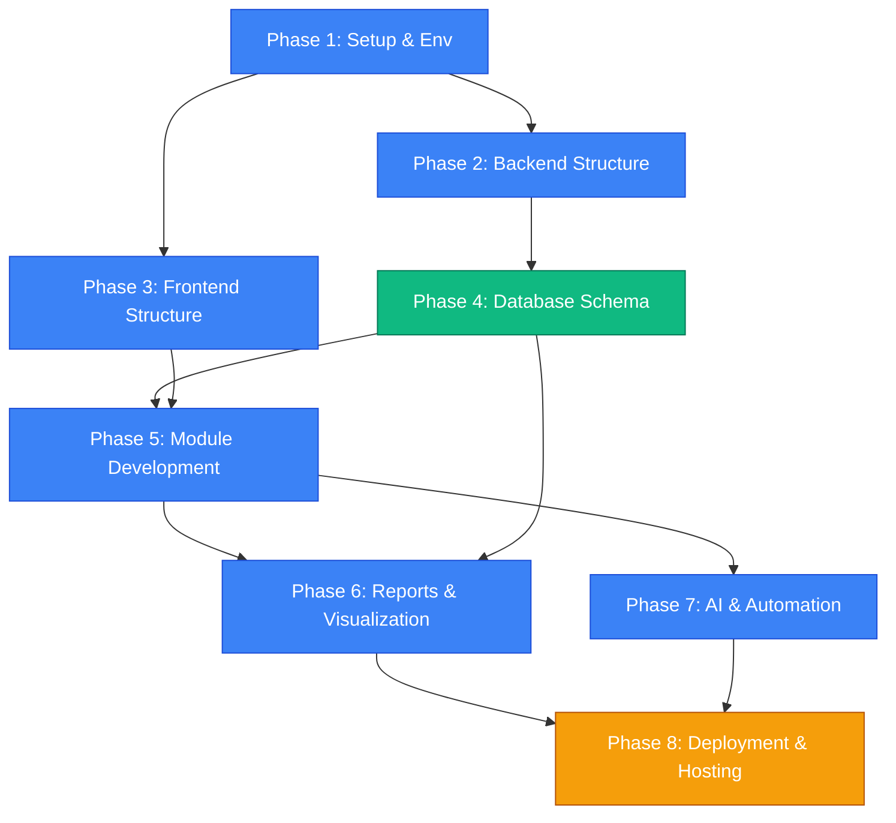

# Meghani Connect 360 – Master Project Execution Tracker

**Role:** Principal Software Architect, Technical Project Manager & Quality Assurance Lead  
**Working Repository:** `D:\ASC\Meghani-Connects`  
**Document Location:** `docs/PROJECT_EXECUTION_TRACKER.md`  
**Ecosystem Applications:**
1. **Meghani Watch Co.** – Public Luxury Digital Boutique (`/(public)` routes)
2. **Saff (Staff) Portal** – In-Store Operational Management Desk (`/(dashboard)` & `/(auth)` routes)
3. **Meghani Connect 360** – Central Django REST Framework ERP/POS Engine
**Last Updated:** November 17, 2026  
**Architecture Reference:** [ARCHITECTURE_REPORT.md](./architecture/ARCHITECTURE_REPORT.md)  
**Reconciliation Reference:** [PROJECT_RECONCILIATION_REPORT.md](./audits/PROJECT_RECONCILIATION_REPORT.md)  
**Code Audit Reference:** [CODE_VERIFICATION_AUDIT.md](./audits/CODE_VERIFICATION_AUDIT.md)  
**Deployment Guide:** [DEPLOY.md](./deployment/DEPLOY.md)  

---

## 1. Project Overview

| Dimension | Details |
|:---|:---|
| **Project Name** | Meghani Connect 360 (Meghani Watch Co.) |
| **Primary Client** | Meghani Watch Co. (Est. 1984, Vadodara, Gujarat) |
| **Core Objective** | Unify luxury watch retail, repair atelier ticketing, POS billing, inventory control, CRM loyalty, and AI forecasting into one centralized system. |
| **Backend Stack** | Python 3.11+, Django 4.2.9 LTS, Django REST Framework 3.14, SimpleJWT |
| **Frontend Stack** | Next.js 14.2.35 App Router, React 18, TypeScript 5.3, Tailwind CSS 3.4, Framer Motion 12.27 |
| **Database & Cache** | PostgreSQL 15 (Production target), SQLite 3 (Development seed), Redis 7 |
| **Async & Analytics** | Celery 5.3.6, Celery Beat, Facebook Prophet 1.1.5, ReportLab 4.0.9, Twilio SDK |
| **Audit Status** | Full-Stack Static & Dynamic Verification Completed Nov 17, 2026 |

---

## 2. Overall Progress Dashboard

```
========================================================================================
                              PROJECT PHASE HEALTH SUMMARY
========================================================================================
Total Project Phases:            8
├── Completed Phases:            1  (12.5%)  [Phase 4: Database Schema]
├── Partially Completed Phases:  6  (75.0%)  [Phases 1, 2, 3, 5, 6, 7]
├── In-Progress Phases:          0  ( 0.0%)
├── Pending Phases:              0  ( 0.0%)
├── Blocked Phases:              0  ( 0.0%)
└── Phases Requiring Verification: 1 (12.5%)  [Phase 8: Deployment & Hosting]
----------------------------------------------------------------------------------------
OVERALL TASK COMPLETION:         47 / 60 Verified Tasks  (78.33%)
├── Completed & Verified:        47
├── Partially Completed:          9
├── In-Progress:                  0
├── Pending / Not Started:        2
├── Blocked:                      1
└── Needs Verification:           1
========================================================================================
```

> **Strict Accounting Note:** Only verified tasks with direct source code or passing test evidence are classified as Completed. Blocked, pending, partially completed, and unverified tasks are excluded from the completed total.

---

## 3. Master Phase Status Table

| Phase | Phase Name | Total Tasks | Completed | Partial | In Progress | Pending | Blocked | Needs Verification | Overall Status |
|:---:|:---|:---:|:---:|:---:|:---:|:---:|:---:|:---:|:---:|
| **Phase 1** | [Core Architecture & Setup](./01-phase-1-setup.md) | 7 | 6 | 1 | 0 | 0 | 0 | 0 | **PARTIALLY COMPLETED** |
| **Phase 2** | [Backend Folder Structure](./02-phase-2-backend.md) | 6 | 4 | 2 | 0 | 0 | 0 | 0 | **PARTIALLY COMPLETED** |
| **Phase 3** | [Frontend Folder Structure](./03-phase-3-frontend.md) | 7 | 6 | 1 | 0 | 0 | 0 | 0 | **PARTIALLY COMPLETED** |
| **Phase 4** | [Database Schema](./04-phase-4-database.md) | 9 | 9 | 0 | 0 | 0 | 0 | 0 | **COMPLETED** |
| **Phase 5** | [Module Development](./05-phase-5-modules.md) | 11 | 8 | 2 | 0 | 1 | 0 | 0 | **PARTIALLY COMPLETED** |
| **Phase 6** | [Reports & Visualization](./06-phase-6-reports.md) | 6 | 5 | 1 | 0 | 0 | 0 | 0 | **PARTIALLY COMPLETED** |
| **Phase 7** | [AI Automation Features](./07-phase-7-ai.md) | 8 | 4 | 2 | 0 | 1 | 1 | 0 | **PARTIALLY COMPLETED** |
| **Phase 8** | [Deployment & Hosting](./08-phase-8-deployment.md) | 6 | 5 | 0 | 0 | 0 | 0 | 1 | **NEEDS VERIFICATION** |
| **TOTAL** | **8 Phases** | **60** | **47** | **9** | **0** | **2** | **1** | **1** | **78.3% VERIFIED** |

---

## 4. Detailed Phase Breakdown

---

### Phase 1: Core Architecture & Environment Setup

* **Reference Document:** [01-phase-1-setup.md](./01-phase-1-setup.md)
* **Mapped Order:** Order 1 (Project Foundations & Environment)
* **Phase Objective:** Establish the development environment, version control, runtime frameworks, and basic security communication pipes.
* **Original Requirements:** Git repository setup, Django backend project, Next.js frontend project, PostgreSQL environment configuration, CORS configuration, JWT authentication base, and API testing environment.

#### Task-by-Task Checklist:
- [x] **Task 1.1: Git Repository Setup** – `COMPLETED`  
  *Evidence:* Active Git repository with 4 commits, master branch tracked, comprehensive `.gitignore` in place.
- [x] **Task 1.2: Django Backend Project Initialization** – `COMPLETED`  
  *Evidence:* `backend/manage.py`, `backend/core/settings.py`, `urls.py`, `wsgi.py`, `asgi.py`.
- [x] **Task 1.3: Next.js Frontend Project Initialization** – `COMPLETED`  
  *Evidence:* `frontend/package.json` (Next.js 14.2, TypeScript 5.3, Tailwind CSS 3.4).
- [ ] **Task 1.4: PostgreSQL Configuration** – `PARTIALLY COMPLETED`  
  *Evidence:* PostgreSQL configuration present in `backend/core/settings.py` via `DATABASE_URL` / `DATABASES['default']` with `psycopg2-binary`. Development environment currently runs on `db.sqlite3`. Live PostgreSQL connection requires cloud/container verification.
- [x] **Task 1.5: CORS Configuration** – `COMPLETED`  
  *Evidence:* `django-cors-headers` installed; configured in `INSTALLED_APPS`, `MIDDLEWARE`, and `CORS_ALLOWED_ORIGINS` (`http://localhost:3000`).
- [x] **Task 1.6: JWT Authentication Base** – `COMPLETED`  
  *Evidence:* `djangorestframework-simplejwt` configured in `settings.py`; `TokenObtainPairView` and `TokenRefreshView` exposed; silent Axios token refresh in `frontend/src/services/api.ts`.
- [x] **Task 1.7: API Testing Environment** – `COMPLETED`  
  *Evidence:* Django test runner active with 30 passing automated tests across core, products, crm, users, sales, and analytics.

* **Current Implementation Status:** **PARTIALLY COMPLETED** (6/7 verified tasks)
* **Outstanding Work:** Verify production PostgreSQL connection against live database instance.
* **Dependencies:** None.
* **Completion Criteria:** Live PostgreSQL instance connects successfully and runs migrations.
* **Recommended Next Action:** Configure `.env` with live PostgreSQL credentials during staging/production deployment.

---

### Phase 2: Backend Folder Structure

* **Reference Document:** [02-phase-2-backend.md](./02-phase-2-backend.md)
* **Mapped Order:** Order 2 (Backend Architecture & Data Schema)
* **Phase Objective:** Organize Django backend with a modular app structure, shared utilities, domain routing, and robust configuration.
* **Original Requirements:** Modular app split (`users`, `products`, `sales`, `repairs`, `crm`, `expenses`, `analytics`, `notifications`, `core`), `requirements.txt` dependencies, custom permissions, shared pagination/exceptions.

#### Task-by-Task Checklist:
- [x] **Task 2.1: Modular 9-App Django Structure** – `COMPLETED`  
  *Evidence:* `backend/apps/users`, `products`, `sales`, `repairs`, `crm`, `expenses`, `analytics`, `notifications`, `core` all exist with proper `apps.py` registration.
- [x] **Task 2.2: URL Configuration & Routing Engine** – `COMPLETED`  
  *Evidence:* Central router in `backend/core/urls.py` delegates to individual app `urls.py`.
- [x] **Task 2.3: Python Dependencies Management** – `COMPLETED`  
  *Evidence:* Comprehensive `backend/requirements.txt` locking Django 4.2, DRF, SimpleJWT, Celery, Redis, Prophet, ReportLab, and Pillow.
- [x] **Task 2.4: Django Core Settings Configuration** – `COMPLETED`  
  *Evidence:* `backend/core/settings.py` contains environment loading, `AUTH_USER_MODEL = 'users.User'`, REST_FRAMEWORK defaults, WhiteNoise, and media settings.
- [ ] **Task 2.5: Shared Utilities (`backend/common/`)** – `PARTIALLY COMPLETED (DEAD CODE)`  
  *Evidence:* `backend/common/` exists (`exceptions.py`, `pagination.py`, `permissions.py`, `utils.py`), but has 0 imports across the entire codebase. The active system migrated to `apps.core` and `apps.users`.
- [ ] **Task 2.6: Role-Based Access Control (RBAC) Enforcement** – `PARTIALLY COMPLETED (SECURITY GAP)`  
  *Evidence:* Custom permission classes (`CanManageUsers`, `CanManageProducts`, `CanManageSales`) exist in `apps/users/permissions.py`, but were never attached to ViewSets in `users/views.py`, `products/views.py`, or `sales/views.py`. `ROLE_CHOICES` in `users/models.py` has 2 roles vs 4 roles in `permissions.py`.

* **Current Implementation Status:** **PARTIALLY COMPLETED** (4/6 verified tasks)
* **Outstanding Work:** 
  1. Attach `CanManageUsers` to `UserViewSet` and permissions to other ViewSets.
  2. Synchronize `ROLE_CHOICES` in `users/models.py`.
  3. Clean up or deprecate orphaned `backend/common/` folder.
* **Dependencies:** None.
* **Completion Criteria:** RBAC permissions enforced on all DRF endpoints and verified via automated permission test cases.
* **Recommended Next Action:** Enforce `permission_classes = [CanManageUsers]` on `UserViewSet`.

---

### Phase 3: Frontend Folder Structure

* **Reference Document:** [03-phase-3-frontend.md](./03-phase-3-frontend.md)
* **Mapped Order:** Order 3 (Point of Sale & Inventory Engine) + Public Extension
* **Phase Objective:** Organize Next.js frontend with App Router, reusable components, context providers, and centralized API services.
* **Original Requirements:** App Router route hierarchy (`/(auth)`, `/(dashboard)`), UI component library, Axios client with JWT interceptor, responsive layout wrappers.

#### Task-by-Task Checklist:
- [x] **Task 3.1: App Router Route Hierarchy** – `COMPLETED`  
  *Evidence:* `(auth)` group with `login/page.tsx`; `(dashboard)` group with layout and 10 modules; `(public)` group with luxury storefront.
- [x] **Task 3.2: In-Store ERP / POS Dashboard Pages** – `COMPLETED`  
  *Evidence:* Working pages in `frontend/src/app/(dashboard)/`: `/dashboard`, `/products`, `/sales`, `/sales/history`, `/repairs`, `/customers`, `/expenses`, `/reports`, `/settings`, `/website-cms`.
- [x] **Task 3.3: Reusable UI Component Library** – `COMPLETED`  
  *Evidence:* `Button.tsx`, `Modal.tsx`, `Badge.tsx`, `Input.tsx`, `SortableHeader.tsx`, `Pagination.tsx` in `src/components/ui/`.
- [x] **Task 3.4: Axios Client & JWT Interceptor** – `COMPLETED`  
  *Evidence:* `frontend/src/services/api.ts` provides request/response interceptors with automatic token refresh on 401.
- [x] **Task 3.5: Global Search & Keyboard Shortcuts** – `COMPLETED`  
  *Evidence:* `GlobalSearch.tsx` (hotkey `/`) and `KeyboardShortcutsModal.tsx` (hotkey `?`) mounted in dashboard layout.
- [x] **Task 3.6: Public Digital Boutique Route Cluster** – `COMPLETED`  
  *Evidence:* 11 public route pages (`/`, `/shop`, `/brands`, `/categories`, `/offers`, `/gallery`, `/about`, `/contact`, `/privacy-policy`, `/terms`).
- [ ] **Task 3.7: Component Hygiene & Dead Code Cleanup** – `PARTIALLY COMPLETED`  
  *Evidence:* 6 orphaned components remain unreferenced (`Header.tsx`, `InvoiceTemplate.tsx`, `BulkActionsBar.tsx`, `useBulkSelection.ts`, `FormField.tsx`, `LoadingSpinner.tsx`).

* **Current Implementation Status:** **PARTIALLY COMPLETED** (6/7 verified tasks)
* **Outstanding Work:** Remove or repurpose orphaned frontend components.
* **Dependencies:** None.
* **Completion Criteria:** Zero unreferenced components in `src/components/`.
* **Recommended Next Action:** Delete orphaned components listed in Section 6.

---

### Phase 4: Database Schema

* **Reference Document:** [04-phase-4-database.md](./04-phase-4-database.md)
* **Mapped Order:** Order 2 (Backend Architecture & Data Schema)
* **Phase Objective:** Define and implement complete relational schema with tables, constraints, foreign keys, and indexes.
* **Original Requirements:** Schema and Django models for `users`, `products`, `sales`, `sale_items`, `repairs`, `customers`, `expenses`, `notifications`, `warranty`, and `audit_log`.

#### Task-by-Task Checklist:
- [x] **Task 4.1: Custom User Model & Auth Schema** – `COMPLETED`  
  *Evidence:* `apps/users/models.py` (`User` extending `AbstractBaseUser`).
- [x] **Task 4.2: Product, Brand & Category Catalog Schema** – `COMPLETED`  
  *Evidence:* `apps/products/models.py` (`Product`, `Brand`, `Category`). Unique barcode indexing, soft delete flag (`is_active`), price privacy attributes (`price_visible`, `availability`).
- [x] **Task 4.3: Sales & SaleItem Transaction Schema** – `COMPLETED`  
  *Evidence:* `apps/sales/models.py` (`Sale`, `SaleItem`). `on_delete=models.PROTECT` on products, sequential invoice numbering (`INV-YYYYMMDD-XXXX`), cost price snapshot preservation.
- [x] **Task 4.4: Warranty Management Schema** – `COMPLETED`  
  *Evidence:* `apps/sales/models.py` (`Warranty`). Links to sale, product, customer; computes `expiry_date`.
- [x] **Task 4.5: Watch Repair Workshop Schema** – `COMPLETED`  
  *Evidence:* `apps/repairs/models.py` (`Repair`). Sequential ticket numbering (`REP-YYYYMMDD-XXXX`), `on_delete=models.PROTECT` on customer, 5-stage status choices.
- [x] **Task 4.6: Customer CRM & Loyalty Schema** – `COMPLETED`  
  *Evidence:* `apps/crm/models.py` (`Customer`, `Enquiry`). Unique phone numbers, loyalty points counter, lifetime spend aggregation, website lead capture.
- [x] **Task 4.7: Expense Bookkeeping Schema** – `COMPLETED`  
  *Evidence:* `apps/expenses/models.py` (`Expense`). 8 expense categories, receipt image attachment, date indexing.
- [x] **Task 4.8: Core Settings, AuditLog & Notifications Schema** – `COMPLETED`  
  *Evidence:* `apps/core/models.py` (`BusinessSettings`, `AuditLog`, `GalleryItem`, `Milestone`, `Offer`, `Testimonial`); `apps/notifications/models.py` (`Notification`).
- [x] **Task 4.9: Database Migrations & Initial Seed Data** – `COMPLETED`  
  *Evidence:* `python manage.py makemigrations --dry-run` reports `No changes detected`. SQLite dev database contains 29 products, 110 sales, 277 items, 20 repairs, 15 customers, 18 expenses, 3 users.

* **Current Implementation Status:** **COMPLETED** (9/9 verified tasks)
* **Outstanding Work:** None. Schema is complete and fully in sync.
* **Dependencies:** None.
* **Completion Criteria:** All tables, relationships, and migrations verified. (PASS)
* **Recommended Next Action:** Maintain schema integrity during future feature expansion.

---

### Phase 5: Module Development

* **Reference Document:** [05-phase-5-modules.md](./05-phase-5-modules.md)
* **Mapped Orders:** Order 3 (POS & Products), Order 4 (Repairs & CRM), Order 5 (Expenses & Billing)
* **Phase Objective:** Implement end-to-end business logic and interactive user interfaces for all operational modules.
* **Original Requirements:** Dashboard KPIs, POS billing with barcode scanner, Product CRUD with bulk import, Repair workshop tracking, CRM loyalty points, Expense logging, Website CMS, and Business Settings.

#### Task-by-Task Checklist:
- [x] **Task 5.1: Executive Dashboard & Real-Time KPIs** – `COMPLETED`  
  *Evidence:* `app/(dashboard)/dashboard/page.tsx` fetches `/api/analytics/dashboard/stats/`, `/sales-chart/`, `/recent-activity/`, and `/ai/insights/`.
- [x] **Task 5.2: POS Barcode Billing & Atomic Checkout** – `COMPLETED`  
  *Evidence:* `BarcodeScanner.tsx`, `sales/page.tsx`, `SaleCreateSerializer` decorated with `@transaction.atomic`. Verifies inventory, decrements stock, records cost price, generates invoice, accrues points.
- [ ] **Task 5.3: POS Split / Mixed Payment UI Support** – `PARTIALLY COMPLETED`  
  *Evidence:* Backend model supports `payment_mode='mixed'`. Frontend POS UI only provides single-selection buttons (`cash`, `upi`, `card`), with no split tender inputs.
- [x] **Task 5.4: Product & Inventory Management with Bulk CSV/Excel Import** – `COMPLETED`  
  *Evidence:* `products/page.tsx`, `ProductViewSet`, tabbed product edit modal, `BulkImport.tsx` with `ProductImportService` line-by-line validation.
- [x] **Task 5.5: Watch Repair Workshop & 5-Stage State Machine** – `COMPLETED`  
  *Evidence:* `repairs/page.tsx`, `RepairViewSet`. Full lifecycle (`received` -> `in_repair` -> `ready` -> `delivered` / `cancelled`), automated WhatsApp alert trigger on `ready`.
- [x] **Task 5.6: CRM Customer Directory & Loyalty Points Engine** – `COMPLETED`  
  *Evidence:* `customers/page.tsx`, `CustomerViewSet`. Phone search, loyalty tier badges (Bronze to Platinum), points accrual ($1\text{ pt} / \text{₹}100$) and checkout redemption ($1\text{ pt} = \text{₹}1$).
- [ ] **Task 5.7: Customer Bulk Import Endpoint** – `PENDING / NOT STARTED`  
  *Evidence:* `BulkImport.tsx` provides a Customer import UI dispatching to `/customers/import/`, but no endpoint exists in `apps/crm/urls.py`.
- [x] **Task 5.8: Operating Expense Tracker with Bill Receipt Upload** – `COMPLETED`  
  *Evidence:* `expenses/page.tsx`, `ExpenseViewSet`. Category filtering, receipt image uploads, Net Profit impact.
- [x] **Task 5.9: Website CMS Administration Dashboard** – `COMPLETED`  
  *Evidence:* `website-cms/page.tsx`, `apps/core/views.py`. Full CRUD for promotional banners, brand partners, heritage milestones, gallery photos, and lead enquiry inbox.
- [x] **Task 5.10: Business Settings & Gzip Database Backup Engine** – `COMPLETED`  
  *Evidence:* `settings/page.tsx`, `apps/core/backup_service.py`. Gzip-compressed JSON dumps (`.json.gz`), download, restore, and delete endpoints.
- [ ] **Task 5.11: User Password Change Endpoint** – `PARTIALLY COMPLETED (BUG)`  
  *Evidence:* Frontend calls `POST /api/users/change-password/`. DRF router generates `change_password/` (underscored), resulting in a 404 error from the settings page.

* **Current Implementation Status:** **PARTIALLY COMPLETED** (8/11 verified tasks)
* **Outstanding Work:**
  1. Fix password change URL mismatch in `apps/users/views.py`.
  2. Implement backend endpoint for `/customers/import/` or remove the tab from `BulkImport.tsx`.
  3. Add split-tender input controls in `sales/page.tsx` for `mixed` payments.
* **Dependencies:** Phase 4 models.
* **Completion Criteria:** All 11 checklist items functional and verified via end-to-end user actions.
* **Recommended Next Action:** Fix password change `@action` decorator in `apps/users/views.py`.

---

### Phase 6: Reports & Visualization

* **Reference Document:** [06-phase-6-reports.md](./06-phase-6-reports.md)
* **Mapped Order:** Order 5 (Financial Operations, Expenses & Reporting)
* **Phase Objective:** Generate analytical business reports, financial statements, interactive charts, and multi-format document exports.
* **Original Requirements:** Sales Summary report, Product Performance report, Profit & Loss report, Inventory Valuation report, CSV/Excel/PDF export engine, dynamic ReportLab invoices.

#### Task-by-Task Checklist:
- [x] **Task 6.1: Sales Summary & Trend Analytics Engine** – `COMPLETED`  
  *Evidence:* `apps/analytics/views.py` (`SalesSummaryReportView`). Date range filters, payment breakdown, daily aggregations.
- [x] **Task 6.2: Product Performance & Inventory Turnover Reports** – `COMPLETED`  
  *Evidence:* `ProductPerformanceReportView`. Identifies top-selling timepieces and slow-moving inventory.
- [x] **Task 6.3: Profit & Loss Statement Aggregation** – `COMPLETED`  
  *Evidence:* `ProfitReportView`. Revenue vs Cost of Goods Sold vs Operating Expenses -> Net Profit calculation.
- [x] **Task 6.4: Stock Valuation & Gross Margin Estimation** – `COMPLETED`  
  *Evidence:* `InventoryValuationReportView`. Total units, cost valuation, retail valuation, gross margin projection.
- [x] **Task 6.5: Multi-Format Report Export Service (CSV, Excel, PDF)** – `COMPLETED`  
  *Evidence:* `ReportExportView` (`openpyxl` for Excel, Python `csv`, ReportLab for PDF). Verified in `frontend/src/app/(dashboard)/reports/page.tsx`.
- [ ] **Task 6.6: Dynamic A4 Thermal / ReportLab Invoice Customization** – `PARTIALLY COMPLETED (DEFECT)`  
  *Evidence:* `apps/sales/invoice.py` generates ReportLab PDF invoices. However, store address, phone numbers, and GSTIN are hardcoded dummy text (`Your Business Address...`) rather than dynamically resolved from `BusinessSettings`.

* **Current Implementation Status:** **PARTIALLY COMPLETED** (5/6 verified tasks)
* **Outstanding Work:** Connect `apps/sales/invoice.py` and `apps/sales/views.py` to `BusinessSettings.get_settings()` to inject dynamic store metadata.
* **Dependencies:** Phase 4 models, Phase 5 sales records.
* **Completion Criteria:** ReportLab PDF invoices render verified store address and GSTIN from `BusinessSettings`.
* **Recommended Next Action:** Update `generate_invoice_pdf()` in `apps/sales/invoice.py` with dynamic `BusinessSettings` data.

---

### Phase 7: AI Automation Features

* **Reference Document:** [07-phase-7-ai.md](./07-phase-7-ai.md)
* **Mapped Order:** Order 6 (AI Analytics & Background Automation)
* **Phase Objective:** Implement predictive analytics, inventory forecasting, Celery background task processing, and automated messaging.
* **Original Requirements:** Prophet sales forecasting, stockout date predictor, Celery background worker, automated WhatsApp notifications, SMS fallback, email service, Razorpay gateway.

#### Task-by-Task Checklist:
- [x] **Task 7.1: Facebook Prophet 30-Day Sales Forecasting** – `COMPLETED`  
  *Evidence:* `apps/analytics/services/forecasting.py` (`SalesForecast`). Implements Prophet with weekly/yearly seasonality and rolling moving average fallback.
- [x] **Task 7.2: Inventory Stockout Date Predictor & Sales Velocity Math** – `COMPLETED`  
  *Evidence:* `StockoutPredictionView` calculates sales velocity per product and estimates days until stockout.
- [x] **Task 7.3: Celery & Redis Background Worker Infrastructure** – `COMPLETED`  
  *Evidence:* `backend/core/celery.py`, Redis broker configuration in `settings.py`, Celery Beat schedule configured.
- [ ] **Task 7.4: Celery Beat Automated Cron Schedules** – `PARTIALLY COMPLETED (RUNTIME CRASH)`  
  *Evidence:* Scheduled cron jobs in `apps/analytics/tasks.py` instantiate `Notification` with invalid kwargs (`notification_type` and `template_name`), raising a fatal `TypeError` when triggered.
- [x] **Task 7.5: Outbound WhatsApp Concierge Alerts (Twilio)** – `COMPLETED (CODE WIRED)`  
  *Evidence:* `apps/notifications/services/whatsapp.py` verified. Hooked to repair status changes. (Requires live Twilio credentials for end-to-end delivery).
- [ ] **Task 7.6: Outbound SMS Customer Alerts (Twilio)** – `BLOCKED`  
  *Evidence:* `apps/notifications/services/sms.py` attempts to read `settings.TWILIO_SMS_NUMBER`, which is missing from `backend/core/settings.py`. SMS dispatch will always error.
- [ ] **Task 7.7: Transactional Email Dispatch Service** – `PARTIALLY COMPLETED`  
  *Evidence:* `apps/notifications/services/email_service.py` exists but is orphaned with 0 callers and an unhandled attribute error.
- [ ] **Task 7.8: Razorpay Online Payment Gateway Integration** – `PENDING / NOT STARTED`  
  *Evidence:* Listed in `requirements.txt` and `settings.py`. Zero endpoint, view, or frontend payment integration exists in the codebase.

* **Current Implementation Status:** **PARTIALLY COMPLETED** (4/8 verified tasks)
* **Outstanding Work:**
  1. Fix keyword arguments in `apps/analytics/tasks.py` (`type='whatsapp'`).
  2. Add `TWILIO_SMS_NUMBER = os.getenv('TWILIO_SMS_NUMBER')` in `backend/core/settings.py`.
  3. Determine whether Razorpay is required for online deposit booking; if so, author order creation endpoint.
* **Dependencies:** Celery worker process, Redis 7 instance, external Twilio credentials.
* **Completion Criteria:** Celery Beat morning cron runs without exceptions; Twilio SMS setting added.
* **Recommended Next Action:** Fix keyword arguments in `apps/analytics/tasks.py`.

---

### Phase 8: Deployment & Hosting

* **Reference Document:** [08-phase-8-deployment.md](./08-phase-8-deployment.md)
* **Mapped Order:** Order 7 (Public Luxury Boutique, SEO & Production Deployment)
* **Phase Objective:** Prepare production-ready containers, web server reverse proxy, static/media storage, search optimization, and automated recovery.
* **Original Requirements:** Docker containerization, environment templates, WhiteNoise + Cloudinary storage, SEO microdata, live cloud deployment (Render/AWS), automated database backups.

#### Task-by-Task Checklist:
- [x] **Task 8.1: Docker Containerization & Multi-Container Compose** – `COMPLETED`  
  *Evidence:* `docker-compose.yml`, `docker-compose.dev.yml`, `backend/Dockerfile`, `frontend/Dockerfile` verified.
- [x] **Task 8.2: Production Environment Variable Specification** – `COMPLETED`  
  *Evidence:* `backend/.env.example` and `frontend/.env.example` catalog all required keys.
- [x] **Task 8.3: Static Asset & Cloudinary CDN Media Storage** – `COMPLETED`  
  *Evidence:* WhiteNoise configured for Django staticfiles; `apps/core/cloudinary_service.py` handles image uploads with local media fallback.
- [x] **Task 8.4: SEO Microdata, Dynamic Sitemap & Robots Directives** – `COMPLETED`  
  *Evidence:* Verified JSON-LD schemas (`JewelryStore`, `Product`, `BreadcrumbList`), dynamic `sitemap.ts`, and `robots.ts` blocking internal ERP routes.
- [x] **Task 8.5: Automated Database Backup Archiving & Vault** – `COMPLETED`  
  *Evidence:* `apps/core/backup_service.py` creates gzip-compressed JSON snapshots with one-click restore and deletion.
- [ ] **Task 8.6: Production Cloud Hosting & Reverse Proxy** – `NEEDS VERIFICATION`  
  *Evidence:* Render, Vercel, and AWS EC2 deployment topologies documented in `DEPLOY.md` and `docs/08-phase-8-deployment.md`. Actual live hosting verification requires external cloud credentials and infrastructure provisioning.

* **Current Implementation Status:** **NEEDS VERIFICATION** (5/6 verified tasks)
* **Outstanding Work:** Provision production server, execute Docker Compose, configure domain DNS and SSL certificates.
* **Dependencies:** External cloud credentials (Render / AWS / Vercel), registered domain (`meghaniwatch.com`).
* **Completion Criteria:** Application reachable at production domain over HTTPS with green health checks.
* **Recommended Next Action:** Perform staging deployment on Docker or PaaS provider once cloud credentials are provided.

---

## 5. Cross-Phase Dependencies



---

## 6. Critical Issues, Defects & Blockers

| ID | Issue Description | Severity | Affected File(s) | Impact | Recommended Fix |
|:---:|:---|:---:|:---|:---|:---|
| **CRIT-01** | **Unapplied RBAC Permissions (Privilege Escalation)** | **HIGH (CVSS 8.1)** | [apps/users/views.py](../backend/apps/users/views.py)<br>[apps/products/views.py](../backend/apps/products/views.py)<br>[apps/sales/views.py](../backend/apps/sales/views.py) | Any authenticated staff user can list, edit, or create admin users, or delete sales records. | Attach `permission_classes = [CanManageUsers]` to `UserViewSet` and role classes to other ViewSets. |
| **CRIT-02** | **Celery Beat Background Cron Crash** | **HIGH** | [apps/analytics/tasks.py](../backend/apps/analytics/tasks.py) | Morning scheduled tasks fail with fatal `TypeError` on non-existent `notification_type` keyword. | Change `notification_type='whatsapp'` to `type='whatsapp'` and remove `template_name`. |
| **DEF-01** | **User Password Change 404 URL Mismatch** | **MEDIUM** | [apps/users/views.py](../backend/apps/users/views.py) | Password change from staff settings page always returns HTTP 404. | Add `url_path='change-password'` to `@action` decorator in `UserViewSet`. |
| **DEF-02** | **Hardcoded Store Address in Invoices** | **MEDIUM** | [apps/sales/invoice.py](../backend/apps/sales/invoice.py) | ReportLab invoices print dummy placeholder strings instead of business settings. | Resolve store metadata dynamically from `BusinessSettings.get_settings()`. |
| **BLK-01** | **Missing `TWILIO_SMS_NUMBER` Setting** | **MEDIUM** | [backend/core/settings.py](../backend/core/settings.py) | SMS alert dispatch crashes because `TWILIO_SMS_NUMBER` is not declared. | Add `TWILIO_SMS_NUMBER = os.getenv('TWILIO_SMS_NUMBER')` to `settings.py`. |
| **MISS-01**| **Missing Customer Bulk Import Endpoint** | **LOW** | [BulkImport.tsx](../frontend/src/components/features/BulkImport.tsx) | Frontend offers Customer import dispatching to `/customers/import/` which does not exist. | Create `CustomerImportView` in `apps/crm/` or remove the tab from `BulkImport.tsx`. |
| **MISS-02**| **Razorpay Implementation Absent** | **LOW** | `settings.py`, `requirements.txt` | Razorpay credentials declared but zero integration code exists. | Author order creation endpoint or document as optional future feature. |

---

## 7. Next Recommended Action

### Priority 0 Security & Operational Defect Remediation

1. **Target Phase:** **Phase 2 (Backend Structure)** & **Phase 7 (AI Automation)**
2. **Target Task:** Remediate Critical Issues CRIT-01, CRIT-02, DEF-01, and BLK-01
3. **Required Files:**
   - `backend/apps/users/views.py` (Add `permission_classes = [CanManageUsers]` and `url_path='change-password'`)
   - `backend/apps/analytics/tasks.py` (Fix kwargs to `type='whatsapp'`)
   - `backend/core/settings.py` (Add `TWILIO_SMS_NUMBER = os.getenv('TWILIO_SMS_NUMBER')`)
4. **Expected Outcome:**
   - Staff accounts blocked from unauthorized administrative operations.
   - Password changes from the UI succeed with HTTP 200.
   - Celery Beat tasks execute without raising `TypeError`.
