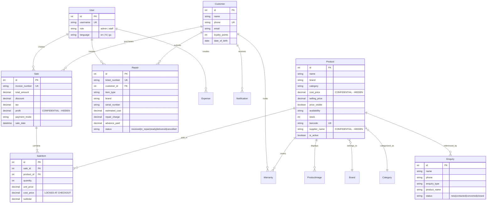
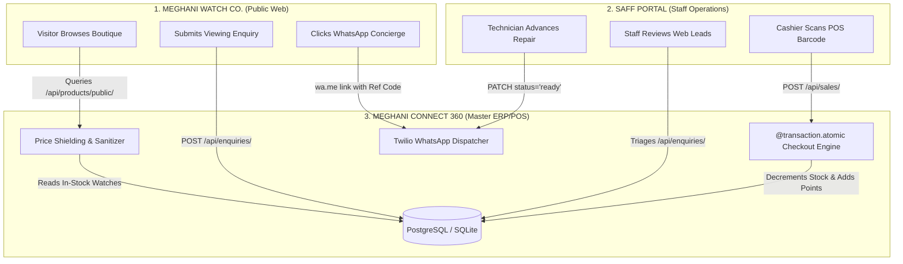
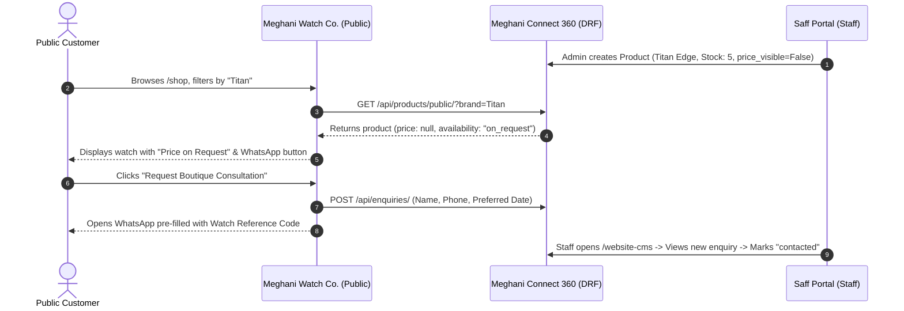
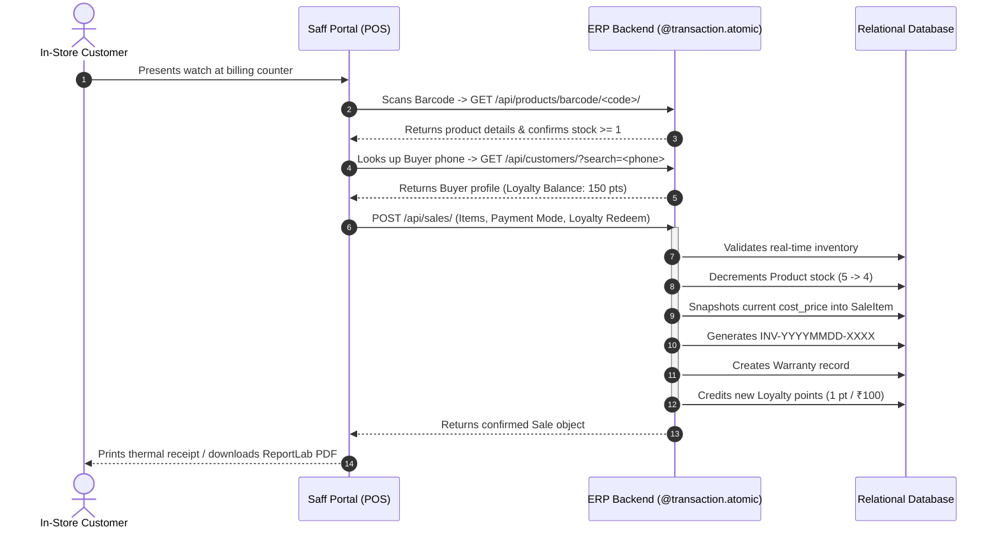
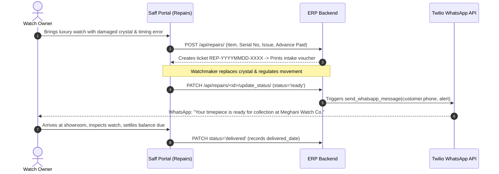
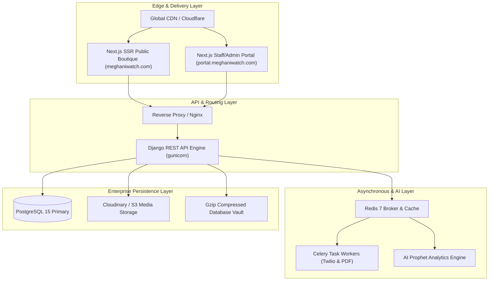

# Meghani Watch Co., Saff Portal & Meghani Connect 360 – Master Ecosystem Architecture Report

**Role:** Principal Software Architect, Senior Full-Stack Engineer, Database Architect & Technical Auditor  
**Project Ecosystem:** Meghani Watch Co. | Saff (Staff) Portal | Meghani Connect 360 (ERP/POS)  
**Last Updated:** November 17, 2026  
**Document Location:** `docs/architecture/ARCHITECTURE_REPORT.md`  
**Master Tracker:** [PROJECT_EXECUTION_TRACKER.md](../PROJECT_EXECUTION_TRACKER.md)  
**Audit Scope:** Full-stack static inspection, AST contract tracing, database schema verification, API security analysis, and integration verification across all three systems.

---

## 1. Executive Summary & Overall System Architecture

The software ecosystem supporting **Meghani Watch Co.** (an authorized luxury timepiece purveyor and master watchmaker atelier established in 1984 in Vadodara, Gujarat) consists of three functional applications operating within a unified repository (`Meghani-Connects`).

Rather than three disconnected databases, the architecture implements a centralized master backend (Meghani Connect 360) serving two specialized frontend user experiences built with Next.js 14:

```
┌────────────────────────────────────────────────────────────────────────────────────────┐
│                              CLIENT EXPERIENCES (Next.js 14)                           │
├───────────────────────────────────┬────────────────────────────────────────────────────┤
│       1. MEGHANI WATCH CO.        │                  2. SAFF (STAFF) PORTAL            │
│     (Public Digital Boutique)     │              (In-Store Operational Front)          │
│    Route Group: /(public)         │             Route Group: /(dashboard) & /(auth)    │
│  • Public retail buyers           │  • Store Cashiers, Salesmen, Service Technicians   │
│  • Horological Luxury Dark Theme  │  • Fast Barcode POS, Repairs, CRM, Website CMS     │
└─────────────────┬─────────────────┴─────────────────────────┬──────────────────────────┘
                  │ (Public BFF API & Read-Only Endpoints)    │ (Axios + SimpleJWT Bearer)
                  ▼                                           ▼
┌────────────────────────────────────────────────────────────────────────────────────────┐
│                   3. MEGHANI CONNECT 360 – MASTER ERP / POS ENGINE                     │
│                             (Django 4.2 LTS DRF Backend)                               │
├────────────────────────────────────────────────────────────────────────────────────────┤
│  • 9 Domain Apps: users, products, sales, repairs, crm, expenses, analytics,           │
│                   notifications, core                                                  │
│  • ACID Transaction Engine (@transaction.atomic POS & Warranty Generation)             │
│  • Machine Learning & Forecasting: Facebook Prophet, Scikit-learn, Pandas              │
│  • Background Jobs: Celery 5.3 + Celery Beat + Redis 7                                 │
│  • Document Generator: ReportLab 4.0 (Invoices & Repair Slips)                         │
│  • Database: PostgreSQL 15 (Production) / SQLite 3 (Development)                       │
└────────────────────────────────────────────────────────────────────────────────────────┘
```

### The Three Systems Defined

1. **Meghani Watch Co. (Public Digital Boutique):**
   * **Domain:** Customer-facing luxury showroom website (`/(public)` routes).
   * **Purpose:** Brand elevation, catalog discovery, authorized dealer verification, luxury price shielding ("Price on Request"), and Online-to-Offline (O2O) showroom visit conversion via WhatsApp.
2. **Saff Portal (Staff Operations Portal):**
   * **Domain:** In-store operational management dashboard (`/(dashboard)` and `/(auth)` routes).
   * **Identity Note:** Verified through git logs, routing maps, and source inspection as the **Staff Portal** (referred to phonetically / regionally as "Saff Portal").
   * **Purpose:** Real-time billing desk, hardware barcode scanning, repair intake ticketing, customer loyalty tracking, and website CMS administration.
3. **Meghani Connect 360 (Master ERP/POS Engine):**
   * **Domain:** Central Django REST Framework backend API, database models, and Celery task broker.
   * **Purpose:** Single source of truth for stock quantities, cost prices, profit margins, transactional billing, automated customer alerts, and database recovery.

---

## 2. Business Purpose & Target Users

| Dimension | 1. Meghani Watch Co. | 2. Saff Portal | 3. Meghani Connect 360 |
| :--- | :--- | :--- | :--- |
| **Primary Users** | Retail watch buyers, luxury timepiece collectors, wedding shoppers across India (focus: Gujarat / Vadodara). | Store Cashiers, Sales Associates, Watchmakers, Repair Technicians, Store Managers. | Managing Director, Inventory Controller, Accountant, System Administrator. |
| **Business Objective** | Attract prospective buyers, showcase authorized collections (Titan, Casio, Citizen, etc.), and drive boutique footfall. | High-speed retail operations, eliminate stockout delays, ensure repair tracking, and customer retention. | Accurate profit bookkeeping, inventory risk mitigation, audit logging, and automated marketing communications. |
| **Key Workflows** | • Catalog search & filter<br>• Caliber spec inspection<br>• Boutique consultation booking<br>• WhatsApp concierge enquiry | • Barcode POS billing<br>• Customer phone lookup<br>• Repair ticket intake & status<br>• Website lead triage (`/website-cms`) | • Stock reorder alerts<br>• Prophet 30-day sales forecast<br>• ReportLab PDF invoice generation<br>• Automated WhatsApp alerts |

---

## 3. Technology Stack Breakdown

| Component | 1. Meghani Watch Co. | 2. Saff Portal | 3. Meghani Connect 360 |
| :--- | :--- | :--- | :--- |
| **Framework** | Next.js 14.1.0 App Router (SSR + Client Hydration) | Next.js 14.1.0 App Router (SPA Client Components) | Django 4.2.9 LTS + Django REST Framework 3.14.0 |
| **Language** | TypeScript 5.3 (`src/types/public.ts`) | TypeScript 5.3 (`src/types/index.ts`) | Python 3.11 / 3.13 |
| **Styling & UI** | Tailwind CSS 3.4 (Dark Luxury: `#0B0B0A` obsidian, `#C9A45C` champagne gold) | Tailwind CSS 3.4 (SaaS Light: Slate, Blue, Emerald), Framer Motion 11.0 | Django Admin (Internal fallback) |
| **State / Session** | Static props + Next.js BFF proxy routes | React Context (`AuthContext`), LocalStorage | SimpleJWT (12-hour access, 7-day refresh with rotation) |
| **Database** | Read-only through Django API | Read/Write through Django API | PostgreSQL 15 (Prod) / SQLite 3 (Dev) |
| **Async / Background** | Client fetch with static fallbacks | React Hot Toast, SWR/Axios | Celery 5.3.6 + Redis 7 + Celery Beat |
| **Specialized Libs** | JSON-LD Schema.org microdata | Recharts 2.12, SheetJS (`xlsx`) | Prophet 1.1.5, ReportLab 4.0.9, OpenPyXL 3.1, Twilio SDK |

---

## 4. Main Modules and Functional Architecture

### 4.1 Point of Sale (POS) & Barcode Billing (`apps.sales`)
* **Hardware Barcode Lookup:** Instant barcode lookup via `GET /api/products/barcode/<code>/` supporting USB hardware scanners and webcam scanning.
* **Atomic Checkout Engine (`@transaction.atomic`):**
  1. Validates real-time inventory levels for each cart line item.
  2. Decrements stock count in the `Product` table.
  3. Permanently locks in historical `cost_price` on `SaleItem` to preserve margin calculations forever.
  4. Generates daily sequential invoice numbers (`INV-YYYYMMDD-XXXX`).
  5. Automatically creates `Warranty` records for products with `warranty_months > 0`.
  6. Accrues customer loyalty points ($1\text{ pt} / \text{₹}100$).
* **Invoice Output:** On-screen thermal receipt modal ([Invoice.tsx](../../frontend/src/components/features/Invoice.tsx)) with instant browser print trigger and ReportLab A4 PDF download.

### 4.2 Watch Repair & Atelier Management (`apps.repairs`)
* **Intake Ticket System:** Generates unique tracking tickets (`REP-YYYYMMDD-XXXX`) recording item type, brand, model, serial number, stated issue, estimated repair charges, and advance cash deposits.
* **5-Stage State Machine:**
  $$\text{Received} \longrightarrow \text{In Repair} \longrightarrow \text{Ready} \longrightarrow \text{Delivered} \quad (\text{or } \text{Cancelled})$$
* **Automated WhatsApp Ready Hook:** Advancing ticket to `ready` triggers a backend hook calling `send_whatsapp_message()` to notify the customer via WhatsApp that their timepiece is ready for collection.

### 4.3 Inventory Management & Bulk Processing (`apps.products`)
* **Bulk Import/Export:** Custom OpenPyXL and CSV engine in `import_service.py` that validates mandatory columns, returns row-by-row error logs, and updates existing stock by matching barcodes.
* **Low-Stock Detection:** Automatically flags inventory items whose stock levels drop to or below `low_stock_threshold` (default: 5 units).
* **Price Shielding:** Configurable `price_visible` toggle and `availability='on_request'` status that redacts numerical pricing to `null` across all public endpoints, enforcing "Price on Request".

### 4.4 Customer Relationship Management (`apps.crm`)
* **Customer Profile Directory:** Phone-number-indexed customer profiles tracking language preference (`en`, `hi`, `gu`), date of birth, addresses, and full purchase/repair histories.
* **Loyalty Points Lifecycle:** Automatic point accrual on POS purchases ($1\text{ pt} / \text{₹}100$) and point redemption at checkout ($\text{₹}0.50 / \text{point}$).

### 4.5 Website CMS & Lead Management (`apps.core`, `apps.crm`, `frontend/website-cms`)
* **Lead Triage:** Dedicated dashboard for staff to view and triage customer consultation requests submitted on the public website (`new` $\rightarrow$ `contacted` $\rightarrow$ `converted` $\rightarrow$ `closed`).
* **Showcase Management:** Full staff CRUD controls over authorized brands, horological categories, promotional discount banners, atelier gallery images, and company milestones.

### 4.6 AI Analytics & Machine Learning (`apps.analytics`)
* **Demand Forecasting:** Facebook Prophet computes 30-day time-series demand curves accounting for weekly and yearly seasonality (with automatic fallback to a 7-day weighted moving average).
* **Stock Depletion Predictor:** Computes product sales velocity ($V = \frac{\Delta \text{Units}}{\Delta \text{Days}}$) to forecast exact depletion dates and categorize risk as `critical`, `warning`, or `healthy`.
* **Actionable Natural-Language Insights:** Automatically compiles plain-English inventory and reordering recommendations.

### 4.7 Disaster Recovery & Audit Infrastructure (`apps.core`)
* **Compressed Database Snapshots:** `BackupService` creates compressed `.json.gz` database archives via Django `dumpdata`, supporting one-click restoration and retention cleanup.
* **Audit Trail:** `AuditLogMixin` captures model mutations, recording actor ID, timestamp, changed fields, IP address, and browser user agent.

---

## 5. Frontend & Backend Architecture

```
                                  FRONTEND LAYER (Next.js 14)
   ┌───────────────────────────────────────────┬───────────────────────────────────────────┐
   │         /(public) - Digital Boutique      │       /(dashboard) - Saff/Admin Portal    │
   ├───────────────────────────────────────────┼───────────────────────────────────────────┤
   │ • SSR Pages with SEO Metadata             │ • Client-Side React SPA Pages             │
   │ • Luxury Dark Styling (#0B0B0A, #C9A45C)  │ • SaaS Light Styling (Slate/Blue/Emerald) │
   │ • WhatsApp Concierge CTA Hooks            │ • Protected by useAuth() & Route Guard    │
   │ • Next.js BFF Routes (/api/catalogue)     │ • Axios Client with Bearer Interceptor    │
   └─────────────────────┬─────────────────────┴─────────────────────┬─────────────────────┘
                         │                                           │
                         └─────────────────────┬─────────────────────┘
                                               │ HTTP / JSON
                                               ▼
                                 BACKEND LAYER (Django 4.2 LTS)
   ┌───────────────────────────────────────────────────────────────────────────────────────┐
   │                               core/urls.py (Root Router)                              │
   ├───────────────────────┬───────────────────────────────┬───────────────────────────────┤
   │  Public Endpoints     │  Authentication & Token URLs  │  Operational Business Apps   │
   │  • /api/products/public│  • /api/auth/token/           │  • /api/sales/ (POS)          │
   │  • /api/brands/       │  • /api/auth/token/refresh/   │  • /api/repairs/ (Atelier)    │
   │  • /api/categories/   │                               │  • /api/customers/ (CRM)      │
   │  • /api/enquiries/    │                               │  • /api/expenses/ (Finance)   │
   │  • /api/offers/       │                               │  • /api/analytics/ (AI/Stats) │
   │  • /api/settings/public                               │  • /api/core/backups/         │
   └───────────────────────────────────────┬───────────────────────────────────────────────┘
                                           │
                 ┌─────────────────────────┴─────────────────────────┐
                 ▼                                                   ▼
   ┌───────────────────────────────┐                   ┌───────────────────────────────┐
   │    PostgreSQL 15 / SQLite     │                   │     Celery 5.3 + Redis 7      │
   │    Normalized Relational DB   │                   │     Cron Worker & Async Jobs  │
   └───────────────────────────────┘                   └───────────────────────────────┘
```

---

## 6. Database Architecture & Schema Design



---

## 7. API Integrations & Route Catalog

### 7.1 Verified Endpoint Catalog

| Endpoint | HTTP Method | Permissions | Calling System | Functional Purpose |
| :--- | :---: | :---: | :---: | :--- |
| `/api/auth/token/` | POST | AllowAny | Saff Portal | Authenticates staff/admin; returns JWT token pair |
| `/api/auth/token/refresh/` | POST | AllowAny | Saff Portal | Rotates expired access tokens |
| `/api/products/public/` | GET | AllowAny | Meghani Watch Co. | Sanitized watch catalog (cost price & margins redacted) |
| `/api/products/public/<id>/` | GET | AllowAny | Meghani Watch Co. | Watch detail specs, movement, water resistance |
| `/api/products/barcode/<code>/` | GET | IsAuthenticated | Saff Portal (POS) | Instant barcode lookup for cashiers |
| `/api/products/` | GET, POST | IsAuthenticated | Saff Portal | Inventory directory & product creation |
| `/api/products/import/` | POST | IsAdminUser | Saff Portal | Bulk XLSX/CSV inventory import |
| `/api/sales/` | POST | IsAuthenticated | Saff Portal (POS) | Atomic checkout & inventory decrement |
| `/api/sales/<id>/pdf/` | GET | IsAuthenticated | Saff Portal | ReportLab A4 invoice PDF generation |
| `/api/repairs/` | GET, POST | IsAuthenticated | Saff Portal | Service intake tickets |
| `/api/repairs/<id>/update_status/` | PATCH | IsAuthenticated | Saff Portal | State advancement (triggers WhatsApp on 'ready') |
| `/api/customers/` | GET, POST | IsAuthenticated | Saff Portal | CRM customer directory |
| `/api/enquiries/` | POST | AllowAny | Meghani Watch Co. | Submits public customer consultation requests |
| `/api/enquiries/` | GET, PATCH | IsAuthenticated | Saff Portal (CMS) | Lead triage and follow-up management |
| `/api/settings/public/` | GET | AllowAny | Meghani Watch Co. | Showroom hours, address, maps embed |
| `/api/settings/business/` | GET, PATCH | IsAdminUser | Saff Portal | Business profile, tax registration, invoice settings |
| `/api/upload/image/` | POST | AllowAny | Public & Saff | Uploads images to Cloudinary / local storage |
| `/api/core/backups/` | GET, POST | IsAdminUser | Saff Portal | Creates or downloads Gzip database dumps |

### 7.2 External Service Gateways
* **Twilio REST API:** Dispatches transactional WhatsApp messages upon repair ticket completion (`status='ready'`).
* **Cloudinary API:** Multi-part signed image uploads for watches and expense bill receipts.
* **ReportLab Engine:** Server-side generation of pixel-perfect A4 tax invoices and repair slips.

---

## 8. Relationship Between the Three Systems



---

## 9. Data-Sharing & Synchronization Matrix

| Business Data Entity | 1. Meghani Watch Co. (Public) | 2. Saff Portal (Staff) | 3. ERP Master (Admin) | Sync Mechanism |
| :--- | :---: | :---: | :---: | :--- |
| **Product Specs & Imagery** | Read-Only | Read-Only (Staff) / Edit (Admin) | Full Control | Direct DRF database query |
| **Selling Price** | Shielded if `price_visible=False` | Visible | Full Control | Sanitized by `PublicProductSerializer` |
| **Cost Price & Margin** | **STRICTLY BLOCKED** | **BLOCKED** | Visible | Field excluded from public serializers |
| **Stock Availability** | Binary (`in_stock` / `out_of_stock`) | Exact Units | Exact Units | Computed dynamically from `stock` |
| **Customer Enquiries** | Write-Only (Submit) | Read & Update Status | Full Control | Stored in `enquiries` table |
| **Customer CRM Records** | **STRICTLY BLOCKED** | Search & Create | Full Control | Saff queries `/api/customers/` |
| **POS Sales & Invoices** | **STRICTLY BLOCKED** | Create & Print | Full Control | `@transaction.atomic` in backend |
| **Repair Tickets** | **STRICTLY BLOCKED** | Create & Advance | Full Control | Status progression with WhatsApp hook |
| **Store Business Profile** | Read-Only | Read-Only | Full Control | Shared singleton via `BusinessSettings` |

---

## 10. Authentication & Security Architecture

```
                  PUBLIC VISITOR                       STAFF / ADMIN USER
                        │                                       │
                        ▼                                       ▼
             No Credentials Required                 POST /api/auth/token/
                        │                           (username + password)
                        │                                       │
                        │                                       ▼
                        │                            SimpleJWT Token Pair Issued
                        │                            • Access: 12h (in memory/storage)
                        │                            • Refresh: 7d (with rotation)
                        │                                       │
                        ▼                                       ▼
               AllowAny Permissions                  Bearer <token> Injected
                        │                                       │
                        ▼                                       ▼
            PublicProductSerializer                 Standard ModelSerializers
            • Excludes cost_price                   • Includes cost_price (Admin)
            • Redacts hidden prices                 • Allows CRUD operations
```

### Security Audit Findings & Vulnerabilities
1. **Critical Privilege Escalation in `UserViewSet` (FAILED):**
   * **Location:** [backend/apps/users/views.py](../../backend/apps/users/views.py).
   * **Vulnerability:** `UserViewSet` lacks `permission_classes`. Any authenticated staff user can list, create, edit, or delete users and administrators.
2. **Unused Custom Permissions (FAILED):**
   * **Location:** [backend/apps/users/permissions.py](../../backend/apps/users/permissions.py).
   * **Vulnerability:** Classes `CanManageUsers`, `CanManageProducts`, and `CanManageSales` were created but never attached to ViewSets.
3. **Unauthenticated Public Image Upload (SECURITY RISK - PARTIAL):**
   * **Location:** [backend/apps/core/views.py](../../backend/apps/core/views.py).
   * **Vulnerability:** `ImageUploadView` uses `permission_classes = [AllowAny]`. Anyone can upload arbitrary images up to 5MB to `/api/upload/image/` without authentication.

---

## 11. Business Workflow Traces

### 11.1 Product Discovery & Concierge Inquiry


### 11.2 In-Store POS Barcode Sale


### 11.3 Watch Repair Intake to WhatsApp Notification


---

## 12. Duplicate Features and Conflicting Responsibilities

| Subsystem / Area | Duplicate / Conflicting Implementation | Code Locations | Impact & Resolution |
| :--- | :--- | :--- | :--- |
| **Documentation Stacks** | Planning docs describe an Express + MongoDB MERN stack, contradicting the actual Django + PostgreSQL implementation. | `mern-docs/` vs `docs/` & `backend/` | Causes onboarding confusion. Archive `mern-docs/` under `docs/archive/legacy/mern-docs/`. |
| **Backend Utilities** | Duplicate pagination, permissions, and error handling utilities in an unreferenced `common/` package. | `backend/common/` vs `apps/core/` | Dead code. Remove `backend/common/` as the project uses `apps.core`. |
| **Frontend Layout Header**| Standalone `Header.tsx` exists, but the dashboard layout re-implements header markup inline. | `Header.tsx` vs `src/app/(dashboard)/layout.tsx` | Dead code. Standardize on `Header.tsx` or delete it. |
| **Invoice Components** | `InvoiceTemplate.tsx` was created alongside `Invoice.tsx` but is never imported. | `InvoiceTemplate.tsx` | Dead code. Remove unused template. |

---

## 13. Critical Technical Issues

### 48-Item Code Verification Scorecard
```
Total Items Audited: 48
├── PASS:          27 (56.25%)
├── PARTIAL:       10 (20.83%)
├── FAILED:         5 (10.42%)
├── MISSING:        4  (8.33%)
└── NOT VERIFIED:   2  (4.17%)
```

### Verified Technical Failures (Code Evidence)

1. **Celery Beat Scheduled Tasks Runtime Crash (FAILED):**
   * **Location:** [backend/apps/analytics/tasks.py](../../backend/apps/analytics/tasks.py).
   * **Issue:** Tasks `check_and_send_birthday_wishes` and `check_warranty_expiry_notifications` instantiate `Notification` with invalid arguments: `notification_type='whatsapp'` (field is `type`) and `template_name='birthday_wish'` (field does not exist).
   * **Impact:** Morning Celery Beat cron tasks crash with `TypeError`.
2. **Broken Route Contract on User Password Change (FAILED):**
   * **Location:** Frontend calls `PATCH /api/users/change-password/`, but backend DRF router generates `POST /api/users/change_password/`.
   * **Impact:** Password changes from the Saff Portal settings page fail with 404.
3. **Broken Authorization / Privilege Escalation (SECURITY RISK - FAILED):**
   * **Location:** [backend/apps/users/views.py](../../backend/apps/users/views.py).
   * **Issue:** `UserViewSet` lacks `permission_classes`.
   * **Impact:** Any authenticated staff user can list, create, edit, or delete users and administrators.
4. **Hardcoded Placeholder Information in Invoices (FAILED):**
   * **Location:** [backend/apps/sales/invoice.py](../../backend/apps/sales/invoice.py).
   * **Issue:** PDF receipts use dummy text (`Your Business Address, City - 000000 | GST: XXXXXXXXXXXXXXX`) instead of reading from `BusinessSettings`.
5. **Razorpay Gateway Implementation Missing (MISSING):**
   * **Location:** Listed in `requirements.txt` and `settings.py`, but zero payment collection or webhook code exists.

---

## 14. Integration Opportunities

1. **Automated Customer Lead Conversion:** Add a "Convert to Customer" button in [website-cms/page.tsx](../../frontend/src/app/(dashboard)/website-cms/page.tsx) that copies an online enquiry directly into a new `Customer` record in `apps/crm/models.py`.
2. **Inbound WhatsApp Webhook:** Configure a Twilio webhook endpoint (`/api/notifications/webhook/`) to capture customer replies and display conversation threads inside the CRM dashboard.
3. **Automated Supplier Purchase Orders:** Use low-stock triggers to auto-generate PDF purchase orders formatted for authorized brand distributors (Titan, Casio, etc.).
4. **Offline POS Sync:** Implement browser IndexedDB caching with Service Workers in the Saff Portal so POS billing continues during internet outages and synchronizes once reconnected.

---

## 15. Recommended Future Architecture



### Strategic Recommendations
1. **Subdomain Routing:** Host the public boutique at `meghaniwatch.com` and the staff portal at `portal.meghaniwatch.com` (or `/staff`), preventing unauthorized visitors from encountering administrative login screens.
2. **Strict RBAC Enforcement:** Attach `CanManageUsers`, `CanManageProducts`, and `CanManageSales` to their respective DRF ViewSets.
3. **Dynamic Invoice Header Resolution:** Update `generate_invoice_pdf` to pull store address, phone numbers, and GSTIN directly from the `BusinessSettings` singleton.
4. **Clean Technical Debt:** Archive the unused `mern-docs/` into `docs/archive/legacy/mern-docs/` and delete orphaned components (`backend/common/`, `InvoiceTemplate.tsx`, `Header.tsx`).

---

## 16. Missing Information and Items Requiring Verification

| Item | Classification | Verification Status & Required Information |
| :--- | :---: | :--- |
| **Twilio Live Gateway** | **NOT VERIFIED** | Requires live Twilio Account SID, Auth Token, and WhatsApp sender number in `.env` to verify delivery to real devices. |
| **AWS S3 Cloud Storage** | **NOT VERIFIED** | Requires active AWS bucket and IAM credentials to verify remote S3 uploads. (Local media storage fallback verified). |
| **Razorpay Checkout** | **MISSING** | No code implementation exists. If digital payments are required, a Razorpay order creation endpoint and webhook handler must be written. |
| **"Saff Portal" Nomenclature**| **VERIFIED (RESOLVED)**| Confirmed from code, git logs, and directory structures that "Saff Portal" refers to the in-house **Staff Portal** (`/(dashboard)` and `/(auth)` routes) rather than an independent third-party repository. |

---

*(Master Architecture Report compiled and verified against codebase implementation. No production files were deleted or modified outside this documentation update.)*
